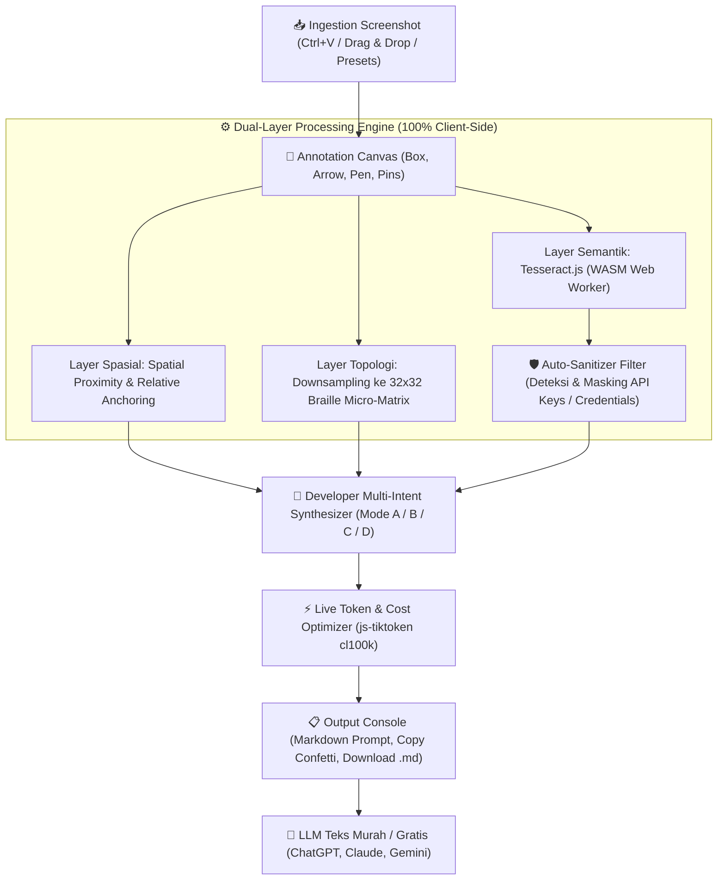

# DevLens AI (Screen2Prompt) 🔍✨
### Client-Side Visual Workspace to Token-Efficient LLM Prompts
> **初音ミク風 UI (Miku UI Edition) • Zero-Server Cost Utility • 100% Client-Side Privacy**

[](https://nextjs.org/)
[](https://www.typescriptlang.org/)
[](https://tailwindcss.com/)
[](https://tesseract.projectnaptha.com/)
[](https://www.docker.com/)

---

## 1. Ringkasan Eksekutif & Problem Statement

Developer modern sangat sering mengunggah tangkapan layar (*screenshot*) berisi terminal error stack trace, kode IDE, tampilan UI yang rusak, atau mockup halaman web dengan coretan kotak merah ke model AI seperti **GPT-4o, Claude 3.5 Sonnet, atau Gemini 1.5 Pro**.

### Perbandingan Masalah Input Screenshot vs Solusi DevLens AI:

| Metode Input | Konsekuensi Teknis | Efisiensi & Biaya | Akurasi Spasial |
| :--- | :--- | :--- | :--- |
| **Vision API Standar (GPT-4o / Claude)** | Mengonsumsi **1.000–1.600 token ($0.012–$0.02)** per screenshot penuh. | **SANGAT BOROS** 💸 | Sering berhalusinasi pada koordinat pixel |
| **Base64 / String Biner Mentah** | 1 byte = 8 karakter teks biner; konsumsi token meledak 4x–8x lipat lebih besar. | **GAGAL TOTAL** ❌ | LLM tidak bisa memetakan posisi tanpa frame spasial |
| **DevLens AI (Hybrid Spatial Pipeline)** | OCR lokal + Bounding Box Interaktif + Spatial Anchoring + Braille Micro-Grid. | **OPTIMAL (~120–250 token, HEMAT 85–95%)** ⚡ | **Akurasi Tinggi** dengan relasi teks alami |

---

## 2. Fitur Unggulan

### 📥 1. Fast Canvas Ingestion
- **Instant Clipboard Paste:** Tekan `Ctrl + V` (atau `Cmd + V` di macOS) di mana saja untuk langsung memuat tangkapan layar dari **Windows Snipping Tool**, **Lightshot**, atau **Mac Screenshot**.
- **Drag & Drop:** Seret file gambar (`.png`, `.jpg`, `.webp`, `.svg`) langsung ke area dropzone.
- **Preloaded Benchmarks:** Dilengkapi 4 contoh preset (E-Commerce UI, Error Stack Trace, Code Refactor, Wireframe Blueprint) untuk pengujian instan tanpa perlu mencari screenshot terlebih dahulu.

### 🎨 2. Interactive Annotation Canvas
- **Bounding Box (Box):** Menandai area target fitur atau error dengan glowing cyan border dan coordinate tracker `[x, y, w, h]`.
- **Directional Arrow:** Menggambar panah penunjuk dari elemen asal ke elemen target.
- **Highlighter Pen:** Kuas bebas dengan smooth path tracking untuk melingkari bagian tertentu.
- **Numbered Pins (`[1]`, `[2]`, `[3]`):** Menandai urutan klik atau hierarki elemen UI secara otomatis.
- **Auto Zoom & Pan:** Kontrol zoom (60% s/d 200%) dengan navigasi presisi.
- **Visual OCR Overlay:** Tombol toggle mata (`Eye`) untuk memvisualisasikan seluruh kotak kata yang terdeteksi OCR di atas gambar.

### ⚙️ 3. Dual-Layer Processing Engine (100% Client-Side)
- **Layer Semantik (Tesseract.js WASM):** Menjalankan OCR di browser Web Worker tanpa freeze UI untuk membaca teks UI, tombol, nama file, nomor baris, dan kode.
- **Layer Spasial (`spatial-analyzer.ts`):** Menghitung relasi posisi kotak anotasi terhadap elemen teks di sekitarnya secara otomatis (contoh: *"Target Box is placed to the RIGHT of '<SearchInput />' and directly ABOVE 'Cart (3)'"*).
- **32×32 Braille Micro-Matrix (`braille-encoder.ts`):** Mengonversi layout visual 2D menjadi matriks karakter Unicode Braille (`\u2800`–`\u28FF`) menggunakan pemetaan bitwise 2×4 dot. LLM berbasis teks dapat memahami topologi tata letak halaman tanpa token visi.
- **Auto-Sanitizer Filter (`sanitizer.ts`):** Memindai dan menyamarkan data sensitif secara otomatis sebelum prompt disintesis:
  * OpenAI API Keys (`sk-...`, `sk-proj-...`)
  * Anthropic & Gemini API Keys
  * AWS Access Key ID (`AKIA...`) & Secret Keys
  * GitHub Personal Access Tokens (`ghp_...`, `github_pat_...`)
  * JSON Web Tokens (JWT `eyJ...`)
  * Database Connection Strings (`postgres://`, `mongodb://`, `mysql://`)
  * Public IP addresses & Private RSA/SSH Keys.
  * Disamarkan menjadi `[REDACTED_OPENAI_KEY]`, `[REDACTED_DB_CONNECTION_STRING]`, dll.

### 🎯 4. Empat Mode Intent Pengembang (Developer Multi-Intent)
1. **Mode A — Feature Request (Add Feature / UI Annotation):**
   * Menghasilkan target bounding box, posisi relatif terhadap elemen tetangga, adjacent elements list, dan instruksi penulisan komponen React/Tailwind.
2. **Mode B — Bug & Terminal Stack Trace:**
   * Mengekstrak klasifikasi error (`TypeError`, `SyntaxError`), lokasi file target dan baris error (`src/...:34:18`), log yang telah disanitasi, serta instruksi patch defensif.
3. **Mode C — Code Refactor & Inspection:**
   * Mengubah screenshot kode menjadi blok teks Markdown monospaced berindentasi rapi, mendeteksi bahasa (TypeScript/JavaScript/Python/Go), dan meminta refaktor performa/strict types.
4. **Mode D — Wireframe & Spatial Topology:**
   * Mengikutsertakan matriks Braille 32×32, rasio densitas, daftar pin UI, dan instruksi pembuatan CSS Grid/Flexbox responsif.

### 📊 5. Live Token & Cost Calculator (`js-tiktoken`)
- Menghitung token exact secara *real-time* menggunakan encoding `cl100k_base` dari `js-tiktoken`.
- Membandingkan token DevLens (~120–250 tokens) vs Vision API (~1.400 tokens).
- Menampilkan persentase penghematan (85%–95%) serta proyeksi penghematan biaya dolar per 1.000 query.

---

## 3. Alur Kerja Sistem (System Workflow Pipeline)

DevLens AI bekerja melalui pipeline pemrosesan lokal 7 tahap berkecepatan tinggi tanpa dependensi jaringan eksternal:



### Rincian 7 Tahap Alur Pemrosesan:

1. **Tahap 1: Fast Ingestion & Normalisasi Citra**
   * Pengguna menempelkan screenshot (`Ctrl + V`) atau melakukan drag-and-drop.
   * Gambar dimuat ke objek `HTMLImageElement` lokal untuk mengukur dimensi asli (`naturalWidth` × `naturalHeight`).
   * Skala rasio layar dihitung agar titik klik mouse akurat terhadap koordinat pixel asli gambar.

2. **Tahap 2: Interactive Annotation & Tracking Koordinat**
   * Pengguna menandai target menggunakan Bounding Box, Panah, Pen, atau Numbered Pins (`[1]`, `[2]`).
   * Setiap anotasi direkam dalam format terstruktur: `{ id, type, x, y, width, height, points, color }`.
   * Sistem menyediakan riwayat *Undo/Redo* penuh berbasis *stack array immutability*.

3. **Tahap 3: Pemrosesan Ekstraksi Semantik (OCR Web Worker)**
   * Gambar dikirim ke Web Worker lokal yang menjalankan **Tesseract.js WASM**.
   * Web Worker mengekstrak seluruh kata dan blok teks beserta koordinat bounding box masing-masing (`{ x0, y0, x1, y1 }`) tanpa memblokir thread UI utama peramban.

4. **Tahap 4: Security & Auto-Sanitizer Filter**
   * Teks mentah hasil OCR langsung dipindai oleh mesin *regex sanitizer* sebelum diproses lebih lanjut.
   * Kunci rahasia seperti OpenAI (`sk-...`), AWS (`AKIA...`), GitHub PAT, token JWT, dan URL database disamarkan menjadi `[REDACTED_SECRET]`.
   * Daftar kunci yang disensor dicatat ke log tab *Sanitizer* untuk inspeksi audit pengguna.

5. **Tahap 5: Perhitungan Spasial & Topologi Braille 32×32**
   * **Relative Anchoring:** Algoritma spasial mencocokkan kotak anotasi pengguna dengan posisi kotak kata hasil OCR. Sistem menghitung elemen terdekat di sisi kiri (*Left*), kanan (*Right*), atas (*Above*), dan bawah (*Below*) serta menentukan kuadran layar (*Upper-Right*, *Center*, dll.).
   * **Braille Micro-Matrix:** Kanvas di-*downsample* menjadi matriks densitas 32×32 pixel dan dikonversi menggunakan algoritma bitwise 2×4 dot menjadi karakter Unicode Braille (`\u2800`–`\u28FF`) untuk representasi visual tata letak 2D yang super hemat token.

6. **Tahap 6: Multi-Intent Prompt Synthesis**
   * Modul `prompt-builder.ts` menggabungkan hasil spasial, teks error terfilter, dan instruksi kustom pengguna berdasarkan 4 mode (Feature Request, Bug Debugging, Code Refactoring, atau Wireframe Layout).
   * Prompt Markdown terstruktur langsung dibentuk sesuai konteks teknis yang siap dipahami model AI teks.

7. **Tahap 7: Live Token Calculation & Distribusi Prompt**
   * Library `js-tiktoken` menghitung jumlah token murni dari prompt akhir dan membandingkannya dengan estimasi token Vision API model GPT-4o.
   * Pengguna cukup mengklik tombol **"Copy Prompt"** (dengan animasi confetti) atau **"Download .md"** untuk langsung ditempelkan ke ChatGPT, Claude, atau cursor IDE.

---

## 4. Miku UI Design System 🎵

Antarmuka DevLens AI dirancang dengan sistem desain bernuansa **Hatsune Miku Anime-Tech Aesthetic**:

| Token Desain | Nilai Warna / Radius | Penerapan pada DevLens |
| :--- | :--- | :--- |
| **Primary Cyan** | `#39C5BB` / Hover `#56D8CE` | Tombol aksi utama, tab aktif, border hero card, highlight anotasi. |
| **Light Ice Mint** | `#E0F7F6` / Border `#C7F1EE` | Pill badge, status lencana, panel perbandingan token. |
| **Accent Pink / Magenta** | `#FF6B9D` / `#E12885` | Indikator error aktif, confetti perayaan salin prompt, badge rahasia. |
| **Slate Steel** | `#334155` / `#1E293B` | Teks kontras, panel konsol Markdown, header terminal. |
| **Background Soft Mist** | `#F3F7FA` | Latar belakang bersih bertekstur dot-grid lembut 24px. |
| **Border Radii** | `rounded-3xl` (24px) | Card container, wrapper kanvas, hero banner. |
| **Action Shapes** | Capsule Pill (`rounded-full`) | Tombol navigasi, status bar, chip kategori, tombol salin prompt. |

---

## 5. Struktur Folder Repositori

```text
.
├── Dockerfile                  # Multi-stage Dockerfile (Node 20 Alpine, Standalone <140MB)
├── docker-compose.yml          # Konfigurasi container port 3000:3000
├── .dockerignore               # Optimasi konteks build docker
├── next.config.mjs             # Next.js standalone output & webpack client fallbacks
├── package.json                # Next.js 14, React 18, Tailwind, Tesseract.js, js-tiktoken
├── tailwind.config.ts          # Miku UI tokens, rounded-3xl, shadow-miku
├── postcss.config.mjs          # PostCSS Tailwind config
├── tsconfig.json               # TypeScript strict configuration
├── README.md                   # Dokumentasi lengkap
├── public/                     # Static assets (robots.txt, favicon)
└── src/
    ├── app/
    │   ├── globals.css         # Miku UI dot-grid background & custom scrollbars
    │   ├── layout.tsx          # Root metadata & HTML structure
    │   └── page.tsx            # Main dual-column workspace
    ├── components/
    │   ├── Header.tsx          # Hero masthead dengan Japanese subtext & quick presets
    │   ├── DropZone.tsx        # Drag & drop upload, Ctrl+V paste listener, sample cards
    │   ├── AnnotationCanvas.tsx# Interactive HTML5 Canvas (Box, Arrow, Pen, Pin, Zoom)
    │   ├── Toolbar.tsx         # Floating frosted glassmorphic pill bar
    │   ├── IntentSelector.tsx  # 4 Mode developer intent & prompt customization
    │   ├── MetricsCard.tsx     # Live Token & Cost Optimizer via js-tiktoken
    │   └── OutputConsole.tsx   # Markdown prompt output, OCR viewer, Sanitizer inspector, Braille tab
    ├── hooks/
    │   └── useDevLens.ts       # Master hook (Pipeline, Undo/Redo, Canvas state, Clipboard)
    └── lib/
        ├── types.ts            # TypeScript interfaces & types
        ├── ocr-worker.ts       # Client-side Tesseract.js OCR engine
        ├── spatial-analyzer.ts # Relative anchoring & proximity math
        ├── braille-encoder.ts  # 2x4 bitwise Braille micro-matrix encoder
        ├── sanitizer.ts        # Sensitive secrets & credentials regex filter
        ├── token-counter.ts    # js-tiktoken cl100k calculator & vision pricing formula
        ├── prompt-builder.ts   # 4 developer multi-intent prompt synthesizer
        └── sample-data.ts      # Preloaded SVG benchmark samples
```

---

## 6. Panduan Instalasi & Menjalankan Aplikasi

### Opsi A: Menjalankan Secara Lokal (Node.js)

1. Pastikan Anda telah menginstal **Node.js 18+** atau **Node.js 20+**.
2. Install dependensi:
   ```bash
   npm install
   ```
3. Jalankan server pengembangan lokal:
   ```bash
   npm run dev
   ```
4. Buka peramban di: **`http://localhost:3000`**

### Opsi B: Menjalankan via Docker Compose (Rekomendasi Produksi)

Aplikasi telah dilengkapi `Dockerfile` multi-stage build berukuran ringan (< 140MB) dan `docker-compose.yml`:

1. Build dan jalankan kontainer di latar belakang:
   ```bash
   docker compose up -d --build
   ```
2. Buka antarmuka web pada peramban:
   **`http://localhost:3000`**
3. Cek log kontainer jika diperlukan:
   ```bash
   docker compose logs -f
   ```
4. Untuk menghentikan kontainer:
   ```bash
   docker compose down
   ```

---

## 7. Contoh Output Prompt Hasil Sintesis DevLens

### Contoh 1: Mode A — Feature Request (Tambah Dropdown Filter)
```markdown
[SYSTEM CONTEXT: DEVELOPER UI FEATURE MODIFICATION]
- Target Area: Bounding Box [x: 585, y: 16, w: 140, h: 38] (Right of "Search products, tags, or..", Left of "Cart (3)")
- Adjacent Elements: Search products, tags, or.. (Left), Cart (3) (Right)
- User Intent: "Tambahkan dropdown filter kategori di area yang ditandai kotak."
[TASK FOR LLM]: Generate React/Tailwind component code that fits into the designated target coordinates. Preserve existing styling and responsive container layout.
```
*Token count: ~138 tokens vs ~1.445 tokens pada Vision API (Hemat 90.4%)*

### Contoh 2: Mode B — Bug & Terminal Stack Trace
```markdown
[SYSTEM CONTEXT: RUNTIME BUG & STACK TRACE DEBUGGING]
- Error Classification: TypeError: Cannot read properties of undefined (reading 'map')
- Target Source File: `src/components/ProductGrid.tsx:34:18`
- Sanitized Error Logs:
```
TypeError: Cannot read properties of undefined (reading 'map')
at ProductGrid (src/components/ProductGrid.tsx:34:18)
Environment Dump (Leak Detected):
OPENAI_API_KEY=[REDACTED_OPENAI_KEY]
DATABASE_URL=[REDACTED_DB_CONNECTION_STRING]
```
- User Context: "Identifikasi penyebab crash TypeError dan perbaiki kode dengan defensive null checking."
[TASK FOR LLM]: Identify the root cause, explain why this error occurred, and provide the exact code patch with defensive null checks and proper error handling.
```

---

## 8. Keamanan & 100% Client-Side Privacy Guarantee

- **Zero Image Upload:** Gambar Anda **tidak pernah** dikirimkan ke server backend mana pun. Seluruh kalkulasi matriks, rendering kanvas, dan OCR diproses langsung di dalam memori WebAssembly peramban Anda.
- **Automatic Secret Redaction:** Bila screenshot terminal Anda tanpa sengaja menampilkan token API atau kredensial database, modul `sanitizer.ts` akan secara otomatis menyamarkannya sebelum Anda menyalin prompt ke ChatGPT/Claude.

---

*Dikembangkan untuk efisiensi maksimal developer, QA engineer, dan AI prompt engineers.*
